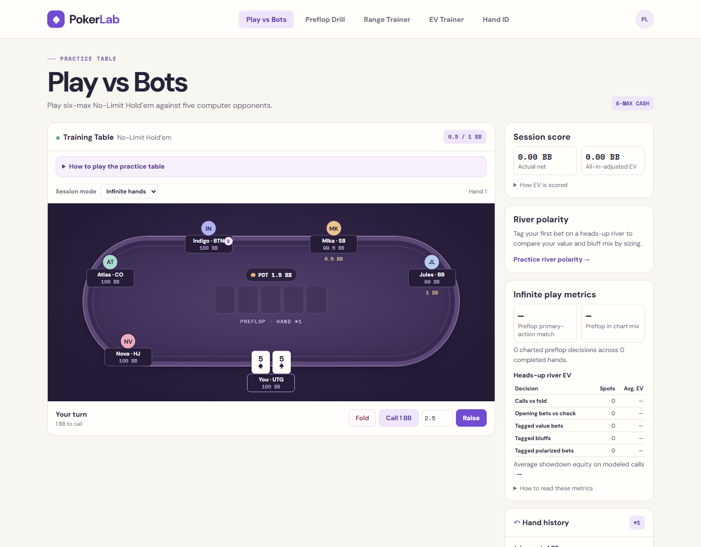
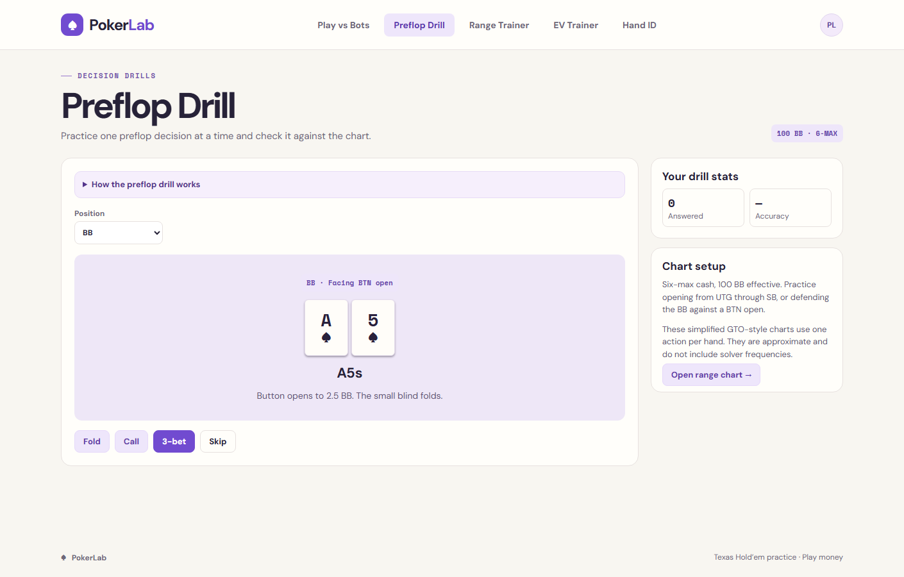
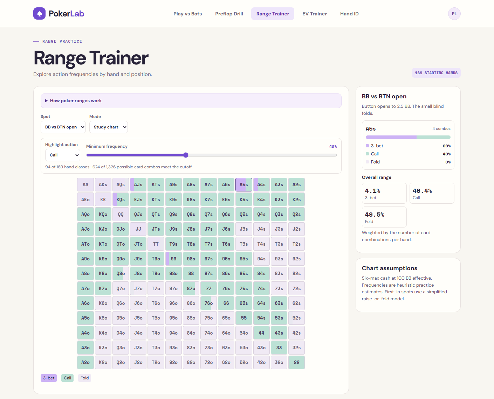
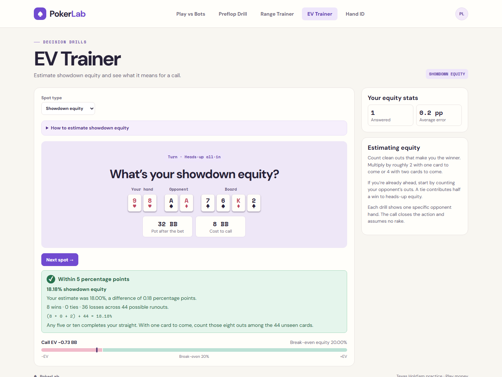
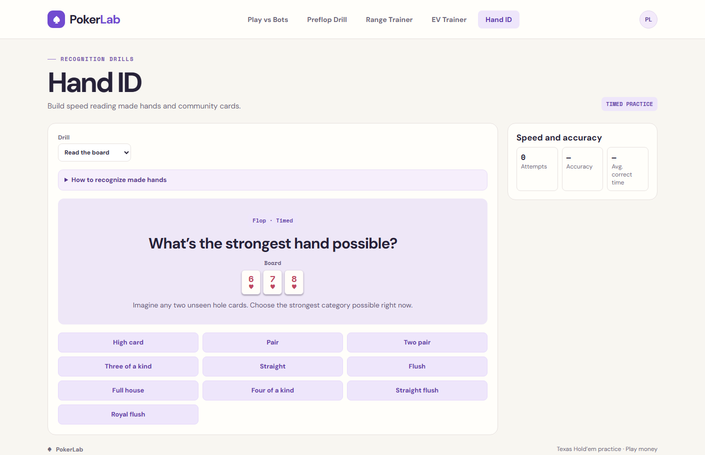

# PokerLab

A play-money Texas Hold’em trainer for six-max cash games. Play full hands against bots, then practice individual skills with worked examples and immediate feedback.

## Quick start

Open `dist/index.html` from a local checkout in your browser. Select a mode from the top navigation. PokerLab runs without an install or a build step.

## Practice modes

| Mode | What you practice |
| --- | --- |
| **Play vs Bots** | Play a single hand or an unlimited session. In unlimited sessions, stacks carry forward and busted players rebuy for 100 BB. Review actual gain or loss, all-in-adjusted EV, preflop chart alignment, and estimated river EV. |
| **Preflop Drill** | Decide whether to open, fold, call, or 3-bet based on your position and the action ahead of you. |
| **Range Trainer** | Explore all 169 starting-hand classes, inspect mixed-action frequencies, filter by a frequency cutoff, and rebuild a range from memory. |
| **EV Trainer** | Find break-even points for calls and bluffs, estimate showdown equity against a known hand, and calculate the bluff share for a polarized river bet. |
| **Hand ID** | Identify your best five-card hand or the strongest hand possible from the board. Track accuracy and average time on correct answers. |

## Trainer previews

Select a screenshot to view it at full size.

| Preflop Drill | Range Trainer |
| --- | --- |
|  |  |
| Choose an action from your cards, position, and the bet you face. | See which hands meet a cutoff and inspect the action mix for any cell. |

| EV Trainer | Hand ID |
| --- | --- |
|  |  |
| See how exact showdown equity compares with the break-even point for a call. | Read the board and identify the strongest hand that two unseen cards could make. |

## Tutorials and progress

Every mode includes an expandable tutorial. Use the **PL** button to view saved training progress in your browser.

The bots use heuristic strategies. Preflop frequencies and modeled river EV are practice estimates. The showdown equity drill enumerates every possible runout for the displayed matchup.

## Deployment

GitHub Actions publishes the contents of `dist/` to GitHub Pages.

In the repository’s **Settings → Pages**, select **GitHub Actions** under **Build and deployment → Source**. Push this workflow to `main`, or run **Deploy PokerLab** from the **Actions** tab. Future changes to `dist/` on `main` deploy automatically.

The deployment URL appears in the workflow’s `github-pages` environment after a successful run. The expected project address is [dogedevyt.github.io/PokerTrainer](https://dogedevyt.github.io/PokerTrainer/).

Progress is stored in each browser. Your local-file progress and the hosted site use separate browser storage.
